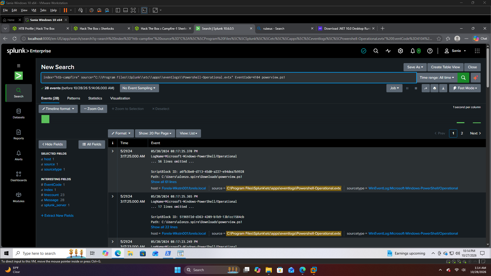
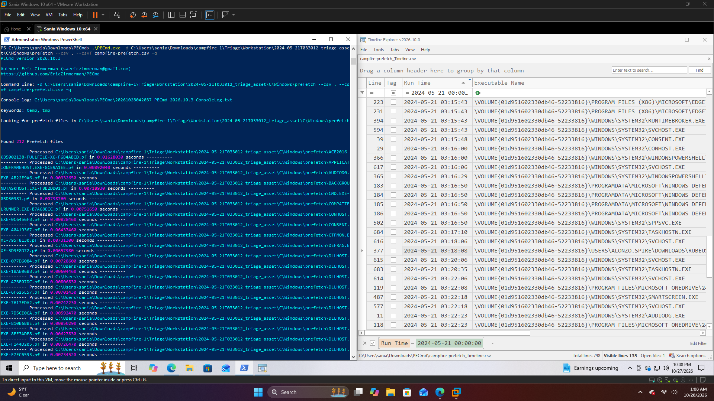

# HTB Sherlock: Campfire-1
## Overview
* **Platform:** Hack The Box - Sherlocks

* **Category:** DFIR

* **Difficulty:** Easy

* **Focus:** Kerberoasting Investigation

* **Tools:** Splunk, Timeline Explorer

## Scenario
Investigated a suspected Kerberoasting attack reported by a user who discovered unusual files on a workstation.

## Investigation
Analyzed the provided evidence using Splunk:

* **Domain Controller Security Logs:** Investigated authentication-related activity.

* **PowerShell Operational Logs:** Examined Powershell execution activity on the affected workstation.

* **Prefetch Files:** Reviewed application execution artifacts for supporting evidence.

## Key Takeaways
* Practiced correlating evidence from multiple Windows log sources.

* Improved familiarity with investigating suspected Kerberoasting activity.

* Used Splunk to support log analysis and incident investigation.

**Status:** Completed

## Evidence

### Splunk Log Analysis

### Timeline Explorer

