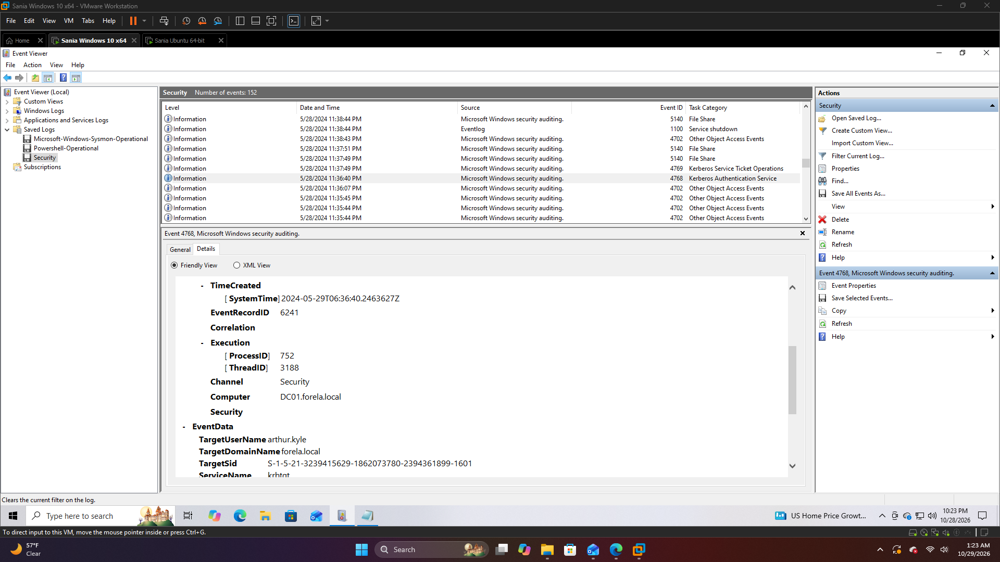

#  HTB Sherlock: Campfire-2
 * **Platform:** Hack The Box

* **Category:** DFIR

* **Difficulty:** Easy

* **Focus:** Windows Event Log Analysis

* **Tools:** Windows Event Viewer

## Scenario
Investigate a suspicious Kerberos TGT request involving an unused administrator account to determine whether it indicates AS-REP Roasting activity.

## Investigation
- **Artifact:** 'Security.evtx' - Domain Controller Security Log.
- **Objective:** Identify suspicoius Kerberos authentication activity and correlate related events.
- **Key Event ID:** '4768' - Kerberos Ticket Granting Ticket (TGT) request.
- **Detection indicator:** 'PreAuthType = 0 , which can indicate a request for an account with Kerberos pre-authentication disabled.

## Findings
- **Timestamp (UTC):** '2024-05-29 06:36:40'
- **Target Account:** 'arthur.kyle'
- **Source IP:** '172.17.79.129'
- **Analysis:** The account received a TGT request without Kerberos pre-authentication, a behavior commonly associated with AS-REP Roasting attempts.

## Skills Learnt
- Windows Event Log analysis
- Active Directory attack investigation
- AS-REP Roasting detection
- Timeline creation and event correlation
- Security event reconstruction from log artifacts

## Key Takeaway
Domain Controller Security logs can reveal indicators of AS-REP Roasting attacks, and correlating authentication events helps validate suspicious activity.

## MITRE ATT&CK
- **T1558.004** - Steal or Forge Kerberos Tickets: AS-REP Roasting

## Evidence
# Event Log Analysis

