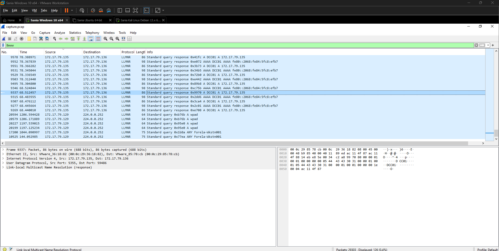
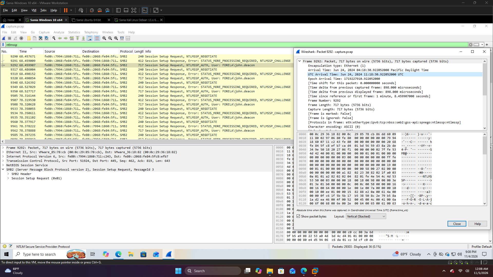
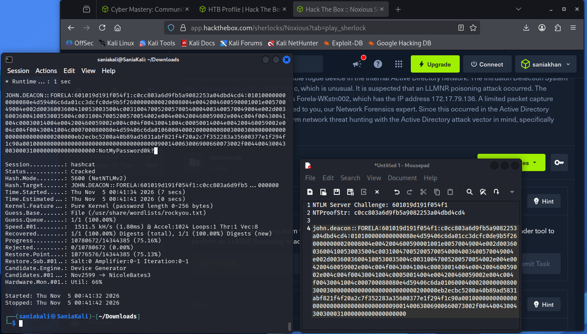

# HTB Sherlock: Noxious

## Overview
* **Category:** SOC/Network Forensics
* **Difficulty:** Very Easy
* **Tools:** Wireshark, Hashcat
* **Artifact:** PCAP

## Scenario
Investigate suspected LLMNR poisoning activity targeting Forela-WKstn002 (172.17.79.136) in a Active Directory network. Identify the rogue device and determine whether user authentication credentials were exposed.

## Investigation
* Analyzed PCAP traffic in Wireshark to identify suspicious LLMNR queries and responses.
* Identified the rogue host by examining LLMNR responses and DHCP information.
* Inspected SMB2 and NTLMSSP traffic to trace authentication attempts.
* Extracted the NetNTLMv2 challenge-response components from the packet capture.
* Used Hashcat to perform offline password cracking and validate credential exposure.
* Examined SMB2 traffic to identify the network share involved in the incident.

## Key Findings
* **Rouge IP:** 172.17.79.135
* **Rouge Hostname:** kali
* **Affected Workstation:** Forela-WKstn002
* **Captured account:** john.deacon
* **Attack Technique:** LLMNR Poisoning
* **Credential Type:** NetNTLMv2
* **Target share:** \\DCC01\DC-Confidential

## Skills Learned
* PCAP Analysis
* LLMNR Poisioning Detection
* Wireshark Traffic Analysis
* SMB2 and NTLMSSP Analysis
* NetNTLMv2 Hash Extraction
* Hashcat Password Cracking
* Active Directory Threat Hunting

## Evidence
### LLMNR Traffic

### NTLM Authentication

### Hashcat Result

