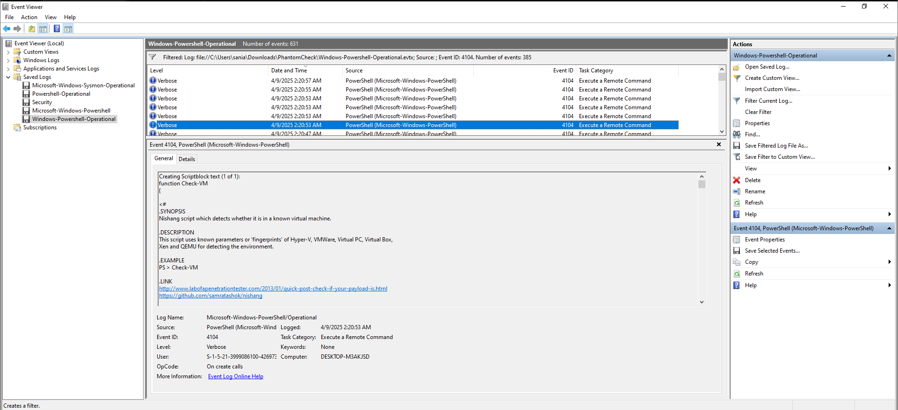

## HTB Sherlock: Operation Blackout 2025: Phantom Check

## Overview
* **Platform:** Hack The Box - Sherlocks

* **Category:** DFIR

* **Difficulty:** Easy

* **Focus:** Anti-Virtualization Detection

* **Tools:** Windows Event Viewer

## Scenario
Investigated suspected anti-virtualization checks performed by a threat actor attempting to evade sandbox-based detection.

## Investigation
* Analyzed .evtx Windows event logs.
* Investigated PowerShell Event IDs 4103 and 4104.
* Identified WMI queries used for VM detection.
* Examined registry keys and running processes.
* Identified virtualization detection techniques.

## Key Findings
* Analyzed .evtx Windows event logs.
* Investigated PowerShell Event IDs 4103 and 4104.
* Identified WMI queries used for VM detection.
* Examined registry keys and running processes.
* Identified virtualization detection techniques.

## Skills Demonstrated
* Windows Event Log Analysis
* Registry Activity Analysis
* Process Execution Investigation
* Anti-Virtualization Detection

## Evidence
### Event Log Analysis

