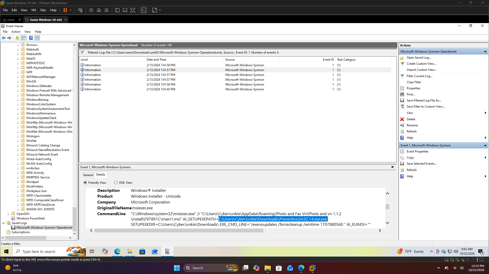

# HTB Sherlock: Unit42
## Overview
* **Platform:** Hack The Box

* **Category:** Sherlocks

* **Difficulty:** Easy

* **Focus:** Windows Event Log Analysis

* **Tools:** Windows Event Viewer

## Scenario
Investigated a Windows system compromised through a backdoored UltraVNC installer. The investigation focused on identifying malicious activity using Sysmon logs and Windows Event Viewer.

## Investigation
Analyzed the provided unit42.zip artifact and examined Sysmon events to investigate:

* **Process Execution (Event ID 1):** Identified suspicious process activity and execution details.

* **File Activity (Event IDs 2 & 11):** Investigated file creation and timestamp manipulation.

* **Network Activity (Event IDs 3 & 22):** Examined network connections and DNS queries.

* **Process Termination (Event ID 5):** Reviewed process termination activity.

## Key Takeaways
* Improved familiarity with Windows Sysmon Event IDs.

* Practiced correlating process, file, and network events.

* Gained experience investigating suspicious activity through Windows Event Viewer.

## Artifacts
* HTB Unit42 Sherlock

* Provided artifact: unit42.zip

* SHA1: 1D8AC45395551187EAF23793CE525056C4136D6E

**Status:** Completed

## Evidence
### Sysmon Event Analysis

